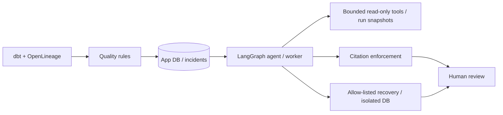

# Data Reliability Copilot

[](https://github.com/Joaolucas2210/data_reliability_copilot/actions/workflows/ci.yml)
[](https://github.com/Joaolucas2210/data_reliability_copilot/actions/workflows/terraform.yml)

Investigates data-pipeline incidents — including the case where **the pipeline succeeds but the report is wrong** —
on a fictional consumer-finance operation with synthetic customers, contracts, installments and payments.

**Rules detect. The agent investigates and proposes. Humans decide.** Every factual claim cites evidence that
is checked programmatically; the agent abstains when evidence is insufficient; recovery runs only in an
isolated, verified sandbox; nothing is applied to production in this phase.

## Principles

| Boundary | Responsibility |
|---|---|
| Rules | Detect failures, including business invariants when dbt succeeds. |
| Agent | Investigate with bounded, read-only tools; propose or abstain. |
| Citations | Enforce evidence existence and literal quotes programmatically. |
| Recovery | Validate allow-listed playbooks in a separate DB and role; fail closed. |
| Human | Approve or reject; production remediation remains a human action. |

## Architecture



See the [full component and deployment diagrams](docs/architecture/overview.md).

## Quickstart

```bash
make setup     # Python 3.12 venv via uv + web deps
make demo      # Postgres → synthetic data with a duplicated batch → dbt (+OpenLineage) → checks → incident
               # → investigation (fake LLM) → recovery validated in an isolated sandbox
make api & make web   # UI at http://127.0.0.1:5173 (link printed by make demo)
make test      # unit + integration
make eval      # benchmark (dev split); make eval-final for the held-out split

```

Details, profiles (Marquez, Jaeger) and resource use: [local runbook](docs/operations/local-runbook.md).

## Repository map

| Path | What |
|---|---|
| `src/drc/` | modular monolith: `synth` `scenarios` `pipeline` `quality` `tools` `agent` `citations` `llm` `fake_llm` `recovery` `evaluate` `store` `domain` `obs` `api` `worker` `cli` |
| `dbt/` | dbt project (staging → marts → `rpt_daily_collections`), contracts, tests, freshness, Elementary |
| `benchmark/scenarios/catalog.yaml` | 24 scenarios with ground truth (19 executable: 10 dev, 9 held-out final) |
| `recovery/playbooks/` | allow-listed recovery playbooks (`dedupe_payments`) |
| `web/` | React + TypeScript UI, design tokens, component gallery, axe tests |
| `infra/local/` | Postgres roles/DBs bootstrap, Marquez config |
| `infra/terraform/` | Azure reference path; AWS/GCP foundations; `check.sh` (fmt + validate) |
| `tests/` | unit + integration (isolation, resume, idempotency, leakage, authz, snapshots, cancel, lease, retention) |
| `docs/` | [spec](docs/product/spec.md) · [architecture](docs/architecture/overview.md) · [domain](docs/architecture/domain-model.md) · [reliability](docs/architecture/reliability.md) · [agent](docs/architecture/agent.md) · [quality & lineage](docs/architecture/quality-and-lineage.md) · [recovery](docs/architecture/recovery.md) · [API](docs/architecture/api-contract.md) · [benchmark](docs/benchmark/README.md) · [design system](docs/design-system/README.md) · [multicloud](docs/multicloud/equivalence-matrix.md) · [ADRs](docs/adr/README.md) · [SLOs & runbooks](docs/operations/slos-and-runbooks.md) · [sources](docs/sources.md) · [report](docs/report/phase-1-report.md) |

## Stack (pinned; [sources and verification](docs/sources.md))

| Layer | Version |
|---|---|
| Runtime / database | Python 3.12.14 / PostgreSQL 17.11 |
| Transformations | dbt-core 1.12.5 / dbt-postgres 1.11.0 / Elementary 0.26.0 |
| Lineage | OpenLineage 1.53.0 / Marquez 0.51.1 |
| Investigation | LangGraph 1.2.14 / checkpoint-postgres 3.1.2 / Anthropic SDK 1.12.1 |
| API / evaluation | FastAPI 0.143.0 / MLflow 3.17.0 / OpenTelemetry 1.45.1 |
| UI | React 19.3.0 / TypeScript 7.0.2 / Vite 8.3.4 |
| Infrastructure | Terraform 1.16.5 / azurerm 5.9.0 / aws 6.68.0 / google 8.6.0 |

## Results

**Agent accuracy numbers below use the deterministic fake LLM (fake-v2) unless labelled LIVE.
Live evaluation is implemented but requires ANTHROPIC_API_KEY.**

Historical [phase-2 evidence](docs/evidence/phase-2/) (10 dev / 9 final scenarios):

| System | FAKE dev exact cause-set accuracy | FAKE final accuracy | LIVE |
|---|---|---|---|
| A rules | 0.50 | 0.556 | Not run |
| B summary-only | 0.50 | 0.556 | Not run |
| C agent + tools | 1.00 | 1.00 | Not run |

The fake policy tests machinery and held-out variants, not live model quality. Phase 2's final detection
rate was 8/9 due to a subsequently corrected SCH-02 ground truth; the original result is preserved.
Quote matching does not prove entailment. The optional groundedness judge has separate structural FAKE
and semantic LIVE modes; exact cause-set scoring remains authoritative.
See the [LIVE results template](docs/evidence/live/RESULTS_TEMPLATE.md) and [protocol](docs/benchmark/live-eval-checklist.md).

## Phase status

| Phase | Status |
|---|---|
| [Phase 1](docs/report/phase-1-report.md) | Foundation, vertical slice, isolated recovery; fake evaluation. |
| [Phase 2](docs/report/phase-2-report.md) | Snapshots, 19 executable scenarios, cancellation, leases and retention; fake evaluation. |
| Next | Phase 3 closes fingerprint/judge/packaging gaps; live measurement and human calibration await credentials. |

[ADRs](docs/adr/README.md) · [Local runbook](docs/operations/local-runbook.md) · [3–4 minute demo](docs/demo/SCRIPT.md)

## Checks

`make check` = ruff format + lint, mypy, unit tests, UI typecheck/build/contrast, Terraform fmt/validate.
CI (`.github/workflows/ci.yml`, `terraform.yml`) adds integration tests on a Postgres service, the end-to-end demo,
gitleaks, pip-audit, npm audit, Playwright + axe, dependency review. CI runs on GitHub Actions for every push to `main` and every PR.
