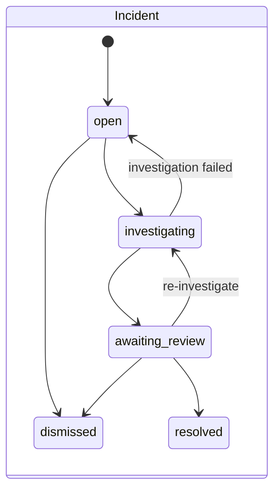
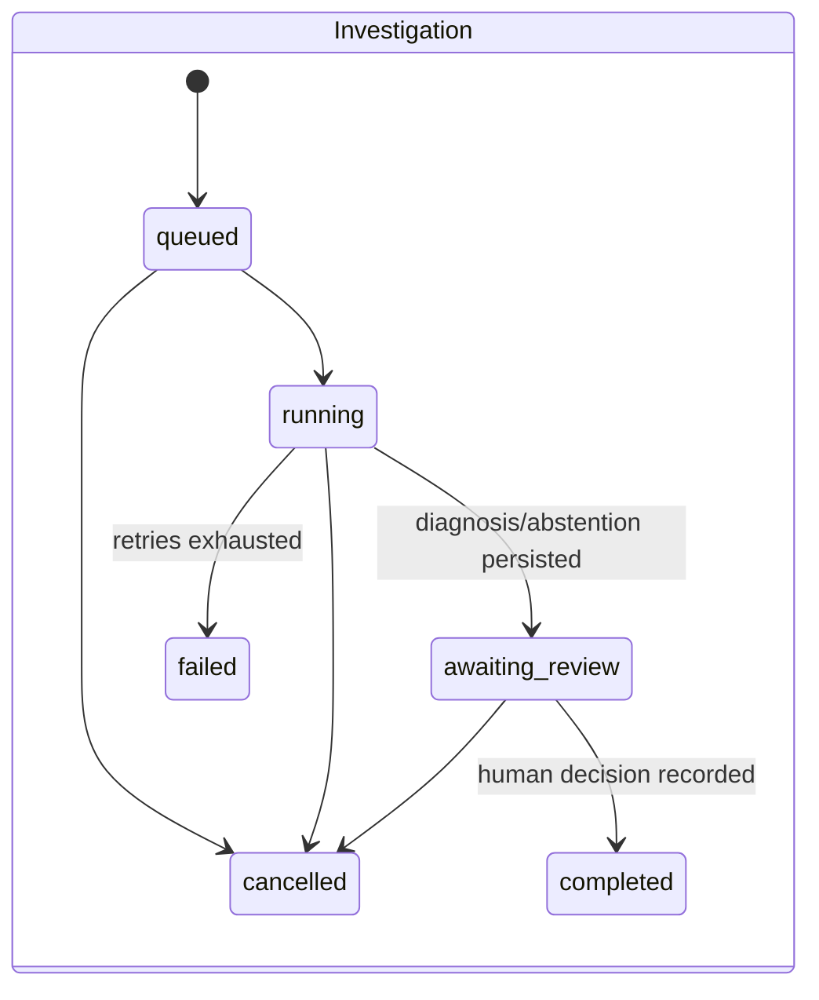
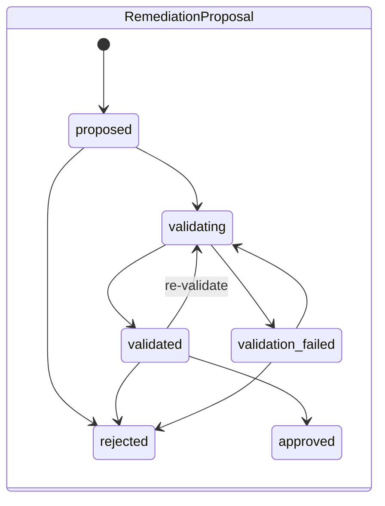

# Domain model

Source of truth: `src/drc/domain.py` (types, transitions) and `src/drc/migrations/0001_init.sql` (storage).

## Conventions

| Aspect | Rule |
|---|---|
| Identifiers | `<prefix>_<12 hex ms timestamp><8 hex random>` (`run_`, `inc_`, `inv_`, `val_`, `job_`, `chk_`), time-sortable. Exceptions: `Evidence.id = ev_ + sha256(source\|locator\|content_hash)[:16]` (content-addressed: same fact → same id); `RemediationProposal.id = prop_<investigation suffix>` (one per investigation, replay-safe); `tool_call.id` from its idempotency key. |
| Timestamps | `timestamptz`, UTC. `created/opened/started/finished/closed_at` per entity; Evidence distinguishes `collected_at` (when we read it) from `observed_at` (when it happened, if known). |
| Versioning | Mutable rows with a lifecycle (`incident`, `investigation`, `remediation_proposal`) carry `version`, incremented on each status change. Artifacts carry content hashes (`pipeline_run.manifest_hash`, evidence `version` = file/SQL hash or dbt version). Prompts carry `investigation.prompt_version`. |
| Consistency | Status changes go through `store.transition()`: row lock (`SELECT … FOR UPDATE`), transition table check, version bump and `audit_event` insert **in the same transaction**. Cross-entity changes (e.g. investigation→awaiting_review + incident→awaiting_review) share one transaction. |
| Ground truth | `pipeline_run.scenario_id` exists only for the benchmark harness; it is hidden by the API and never read by tools. |

## Entities

| Entity | Key fields | Notes |
|---|---|---|
| PipelineRun | pipeline, status (`running/succeeded/failed`), dbt_version, manifest_hash, artifacts_dir, idempotency_key | "succeeded" = transformations ran; failing tests do not fail the run (that is the point of the product). |
| Dataset | namespace, name | Lineage identity (`warehouse.marts.rpt_daily_collections`). Table defined; populated lineage lives in OpenLineage events/Marquez in phase 1. |
| QualityCheckResult | check_type (`schema_contract/data_test/freshness/invariant/anomaly`), status (`pass/warn/fail/error/skipped`), failures, observed/expected | Unique per (run, check_name). |
| Incident | fingerprint, severity, status, first/last run, occurrences | At most one non-terminal incident per fingerprint (partial unique index). |
| Evidence | kind, source, pipeline_run_id, collected_at, observed_at, version, locator, content (≤4000 chars, untrusted), content_hash, access (`public/internal/restricted`) | Immutable. |
| Investigation | status, mode (`fake/live`), llm_provider/model, prompt_version, outcome, diagnosis (JSON), citation_report, usage, limits | |
| Hypothesis | statement, status (`supported/refuted/inconclusive`), cause_category, supporting/contradicting evidence ids | Rewritten from the final diagnosis. |
| RemediationProposal | playbook (allow-listed), rationale, evidence_ids, status | Approval ≠ application (no production apply in phase 1). |
| ValidationRun | sandbox_db, steps[], isolation_checks[], metrics_before/after, invariants[], cleaned_up_at | |
| AuditEvent | actor, action, entity, from/to status, detail, trace_id | Append-only. |

## State machines

`approved` requires a passed validation (enforced: `proposed → approved` is illegal).
ValidationRun: `queued → running → passed | failed | error`.

## Investigation output contract (`Diagnosis`)

`outcome` (`diagnosed | abstained | no_fault_found`), `summary`, `observed_facts[]` (statement, evidence_ids ≥1,
verbatim `quote`), `hypotheses[]`, `contradicting_evidence[]`, `missing_information[]`, `estimated_scope`,
`next_step`, `recovery` (playbook, rationale, evidence_ids) or null, `self_reported_confidence` (informational).
