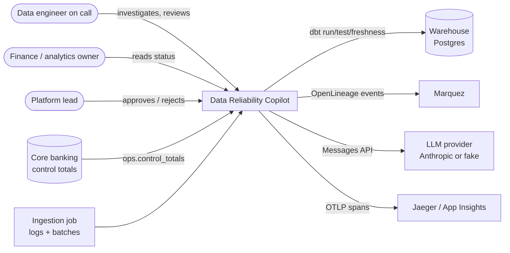
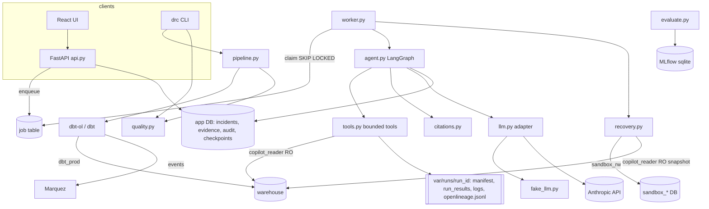
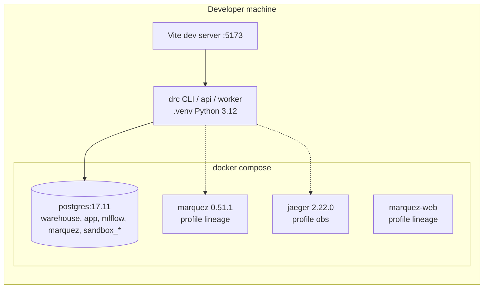
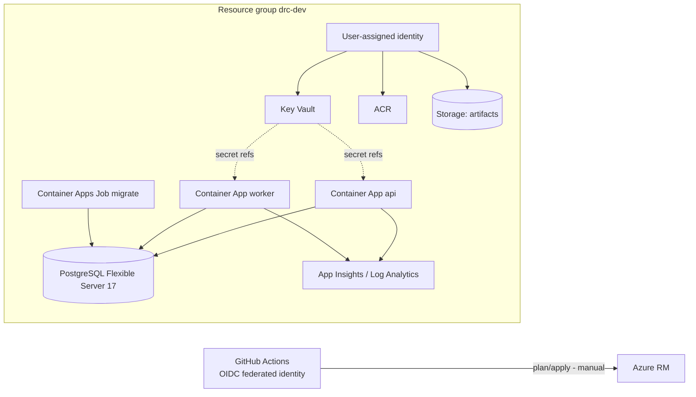
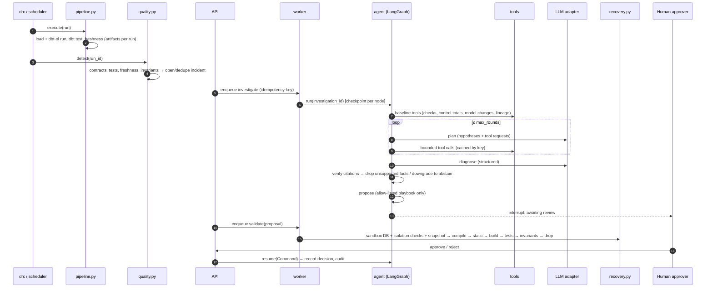

# Architecture overview

Modular monolith (`src/drc/`) + a separate worker process for long-running jobs (ADR-0002).
One Postgres server hosts separate databases with separate roles; nothing shares credentials.

## Module boundaries

| Boundary | Modules | Owns | Talks to |
|---|---|---|---|
| Data & transformations | `synth.py`, `scenarios.py`, `dbt/` | raw/ops schemas, dbt models | warehouse DB as `dbt_prod` |
| Pipeline execution | `pipeline.py` | `pipeline_run`, `var/runs/<run_id>/` artifacts | dbt / dbt-ol subprocesses |
| Quality | `quality.py` | `quality_check_result`, `incident` creation | warehouse as `copilot_reader` (read-only) |
| Metadata & lineage | `tools.get_lineage`, `pipeline.openlineage_config` | OpenLineage events (file + Marquez) | Marquez (optional) |
| Incidents & evidence | `domain.py`, `store.py`, `tools.py` | `incident`, `evidence`, `tool_call`, `audit_event` | app DB as `app` |
| Investigation | `agent.py`, `citations.py`, `llm.py`, `fake_llm.py` | `investigation`, `hypothesis`, LangGraph checkpoints | tools (never SQL/shell directly) |
| Isolated recovery | `recovery.py`, `recovery/playbooks/` | `remediation_proposal`, `validation_run`, `sandbox_*` DBs | sandbox DB as `sandbox_rw` |
| Evaluation | `evaluate.py`, `benchmark/` | `eval_run`, MLflow runs | everything above, as a harness |
| Audit & observability | `obs.py`, `store.audit` | spans, JSON logs, audit trail | OTLP collector (optional) |
| API & UI | `api.py`, `cli.py`, `worker.py`, `web/` | HTTP contract, job queue | app DB |

Rule: modules call each other through Python functions; only `store.py`/`tools.py`/`recovery.py`/`quality.py`
open DB connections, each with the narrowest role that works.

## Context

## Components

## Deployment

Local (implemented, Docker Compose profiles — `docs/operations/local-runbook.md`):

Azure reference (Terraform written and validated, **not applied** — ADR-0011):

## Main sequence — incident to reviewed recovery

Related: [domain model](domain-model.md), [reliability](reliability.md), [agent](agent.md),
[quality and lineage](quality-and-lineage.md), [recovery](recovery.md), [API contract](api-contract.md).
