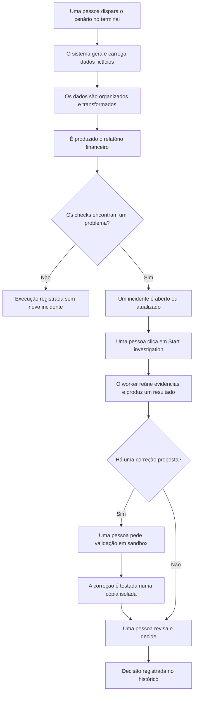
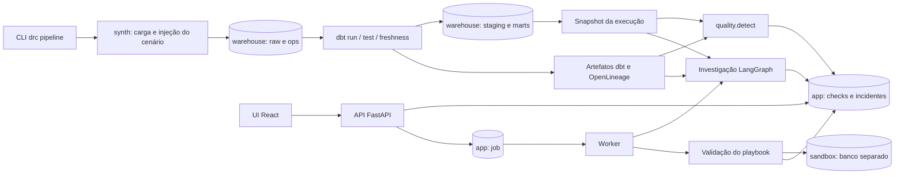
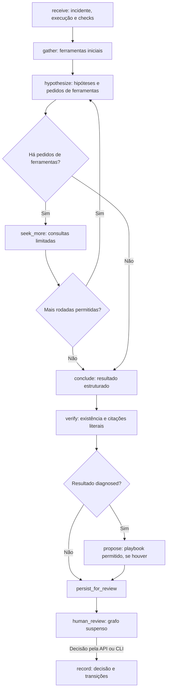
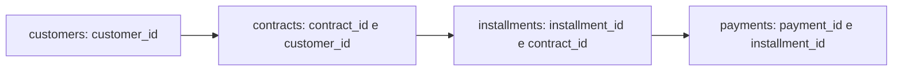

# Guia ponta a ponta do Data Reliability Copilot

Este documento tem dois percursos: [para quem não trabalha com tecnologia](#parte-1-para-quem-não-trabalha-com-tecnologia) e [para um staff engineer](#parte-2-para-um-staff-engineer). O [glossário de engenharia de dados](#parte-3-conceitos-de-engenharia-de-dados) explica os termos usando exemplos do projeto.

O projeto demonstra uma situação comum: o processamento termina sem erro de execução, mas o relatório financeiro está errado. Regras detectam a inconsistência; um investigador reúne evidências e propõe uma explicação; uma pessoa decide. Uma possível correção é testada em uma cópia isolada dos dados.

Os dados são sintéticos. O modo padrão `fake` usa uma política determinística no lugar de um modelo de IA externo. Ingestão, SQL, banco, fila, checks e validação em sandbox são executados de fato nesse modo.

## Parte 1: para quem não trabalha com tecnologia

### 1. Entenda o problema com um exemplo

Imagine que chegaram dez pagamentos de R$ 100. O total correto é R$ 1.000. Se um lote for entregue duas vezes, o relatório pode somar R$ 2.000. O programa consegue executar a soma sem travar: o erro está nos dados, não necessariamente na execução.

O cenário `DUP-01` simula uma entrega duplicada. O sistema compara o que foi publicado com controles independentes e identifica a diferença. Os valores acima são apenas uma ilustração; o cenário usa um conjunto maior de pagamentos.

### 2. Veja o caminho completo



O **worker** é o processo que pega tarefas da fila e as executa. O **sandbox** é um banco separado usado para experimentar a correção.

### 3. Escolha o ambiente que vai usar

Existem dois caminhos. Escolha um e mantenha os comandos e portas desse caminho.

| Serviço | Ambiente padrão do projeto | Ambiente E2E criado em 12/10/2026 |
|---|---|---|
| Interface | `http://127.0.0.1:5173` | `http://127.0.0.1:4174` |
| API, que atende a interface | `http://127.0.0.1:8000` | `http://127.0.0.1:8001` |
| PostgreSQL | porta `55432` | porta `55433` |
| Arquivos de execução | `var/` | `var/e2e-20261012/` |

O ambiente E2E é uma configuração daquela sessão, não o padrão permanente do repositório. Os endereços funcionam enquanto seus processos estiverem ativos.

#### Caminho A: preparar o ambiente padrão

Pré-requisitos: Docker Desktop iniciado, uv, Node 24 e Make. Abra um terminal na pasta do projeto. Os comandos usam `rtk`, conforme a convenção local; se ele não estiver instalado, execute o comando que vem depois de `rtk`.

```bash
unset DRC_PG_PORT DRC_VAR_DIR DRC_API_PORT
rtk make setup
export DRC_LLM_PROVIDER=fake
rtk make demo
```

`make setup` instala as dependências. `make demo` sobe o banco, prepara sua estrutura e executa o cenário completo até a validação da recuperação. Guarde o JSON impresso no final, especialmente `incident_id`, `investigation_id`, `validation_run_id` e `ui`.

Depois abra três terminais na raiz do projeto e execute um comando em cada um. Deixe os terminais abertos:

```bash
# Terminal da API
DRC_LLM_PROVIDER=fake rtk make api
```

```bash
# Terminal da interface
rtk make web
```

```bash
# Terminal do worker
DRC_LLM_PROVIDER=fake rtk make worker
```

Abra `http://127.0.0.1:5173`. A demo já entrega um resultado pronto. Para observar uma nova investigação, use o próximo passo e faça os cliques pela interface.

#### Caminho B: usar o ambiente E2E já preparado

Abra `http://127.0.0.1:4174`. Na raiz do projeto, configure o terminal que vai disparar o processamento:

```bash
export DRC_PG_PORT=55433
export DRC_VAR_DIR="$PWD/var/e2e-20261012"
export DRC_LLM_PROVIDER=fake
```

Essas variáveis valem apenas para esse terminal e seus comandos. Não mudam os processos já iniciados. Neste ambiente, API e worker também precisam usar o banco `55433`, e a interface precisa encaminhar `/api` para `8001`.

### 4. Dispare um novo lote com problema

Com o banco preparado e o terminal configurado para o ambiente escolhido:

```bash
rtk uv run drc pipeline --scenario DUP-01
```

Você verá mensagens das etapas de transformação, testes e detecção. Ao terminar, aparecem `run_id` e `incident_id`.

Cada execução recarrega os dados sintéticos e recria os schemas `raw` e `ops` do warehouse escolhido. Use somente o banco de demonstração. As execuções preservam cópias dos dados e artefatos para investigação.

O comando `pipeline` cria ou atualiza o incidente, mas não inicia automaticamente sua investigação. Se o mesmo problema já estiver aberto, o sistema pode registrar uma nova ocorrência no mesmo incidente. Um teste dbt falhando nesse cenário é um sinal esperado da duplicação.

### 5. Acompanhe a investigação pela interface

1. Abra **Incidents**, atualize a página e procure o `incident_id` retornado pelo terminal.
2. Abra o incidente. Veja os checks que falharam e sua linha do tempo.
3. No seletor de papel, escolha **investigator**. O papel padrão **viewer** só permite leitura.
4. Clique em **Start investigation**. Se houver outra investigação ativa, a interface pode pedir confirmação para iniciar mais uma.
5. Acompanhe os estados: `queued` significa na fila; `running`, em execução; `awaiting_review`, resultado pronto para revisão. A página de investigação atualiza automaticamente enquanto trabalha.
6. Leia os fatos, as hipóteses e as evidências. As chamadas de ferramentas mostram quais consultas e arquivos foram usados.

O investigador pode concluir que encontrou uma causa, que não há evidência suficiente ou que não encontrou falha. A abstenção é um resultado possível: o sistema deve informar o que falta, em vez de inventar uma resposta.

### 6. Teste uma correção e registre a decisão

Quando houver uma proposta de recuperação, clique em **Validate in sandbox**. Acompanhe a página de validação: ela mostra etapas, resultados antes e depois e checks de isolamento.

No cenário de duplicação, a proposta usa o playbook `dedupe_payments`, que mantém uma entrega por identificador de pagamento. A validação deve demonstrar que a cópia corrigida volta a atender às regras e que o warehouse original ficou inalterado.

Depois escolha o papel **approver** e revise o diagnóstico. Você pode aprovar ou rejeitar; a rejeição exige uma nota. Aprovar e marcar o incidente como resolvido são decisões distintas; a interface oferece uma opção explícita para também encerrá-lo.

A aprovação registra a decisão humana. Este projeto não aplica a correção ao warehouse original. Uma investigação sem proposta não terá botão de validação.

### 7. Reconheça as telas e os sinais de problema

| Tela ou situação | O que observar |
|---|---|
| Pipeline health | Última execução, checks e incidentes abertos |
| Incident | Checks que motivaram o alerta, ocorrências e histórico |
| Investigation | Fatos, hipóteses, evidências, chamadas de ferramentas e resultado |
| Sandbox validation | Etapas da correção, comparação antes/depois e isolamento |
| Evaluations | Resultados de benchmark, quando `make eval` tiver sido executado |
| Investigation fica em `queued` | Verifique se o worker está rodando com o mesmo banco da API |
| API unreachable | Verifique a API e a porta usada pelo proxy da interface |
| Sem botão de investigação | Confira o papel selecionado e se o incidente está fechado |
| Sem proposta de recuperação | Leia o resultado e as informações que faltam; não force uma correção |

## Parte 2: para um staff engineer

### 1. Componentes, responsabilidades e persistência

O backend é um monólito modular Python. A API é FastAPI; o processamento de investigação é um grafo LangGraph; transformações usam dbt; PostgreSQL armazena o warehouse, o estado da aplicação e os checkpoints em bancos separados conforme o bootstrap local. A UI é React com Vite.



Não há broker Kafka nem scheduler de ingestão nesse fluxo local. A fila é a tabela `job`. O CLI orquestra o pipeline; o worker processa investigação e validação solicitadas pela API.

### 2. O que dispara o quê

| Gatilho | Execução disparada | Resultado e limite |
|---|---|---|
| `drc pipeline --scenario DUP-01` | `pipeline.execute` e depois `quality.detect` | Carga sintética, transformação, snapshot, checks e incidente; sem investigação automática |
| `drc demo` / `make demo` | Pipeline → detecção → investigação → validação, se houver proposta | Caminho síncrono; dispensa worker para a demo preparada |
| UI: Start investigation | `POST /api/incidents/{id}/investigations` | Cria investigação e job; HTTP 202; worker executa `agent.run` |
| UI: Validate in sandbox | `POST /api/proposals/{id}/validations` | Cria execução de validação e job; HTTP 202 com `validation_run_id` e `job_id` |
| Worker encontra job elegível | `worker.claim` e `worker.handle` | Executa `investigate` ou `validate`; registra conclusão ou retry |
| UI: Approve / Reject | `POST /api/investigations/{id}/review` | Retoma o grafo suspenso, registra decisão e transições; sem aplicação ao warehouse |
| `make eval` | Harness dos cenários do split dev | Executa benchmark e grava métricas; não é necessário para operar uma investigação |

A UI consulta estado via HTTP e faz polling das investigações e validações ativas. Não é um stream WebSocket de todas as etapas do pipeline.

### 3. Pipeline e qualidade

1. `synth.generate` produz clientes, contratos, parcelas e pagamentos reproduzíveis por seed. `synth.load` carrega `raw`, registra lotes em `ops.ingestion_batches` e totais de controle em `ops.control_totals`.
2. O cenário injeta a falha no conjunto de dados ou no projeto dbt copiado para aquela execução. O SQL do repositório não é alterado para simular o cenário.
3. `dbt run`, encapsulado por `dbt-ol`, constrói os modelos e emite OpenLineage. Depois executam `dbt test`, quando o build teve sucesso, e `dbt source freshness`.
4. O pipeline congela relações de `raw`, `ops`, `staging` e `marts` em `snap_<run_id>`. Relações ilegíveis são registradas como limitações do snapshot.
5. `quality.detect` persiste checks e avalia invariantes. Problemas abrem ou atualizam um incidente. A assinatura considera checks, versões de modelos e datas afetadas; reincidências podem compartilhar um incidente aberto.

`pipeline_run.status=succeeded` significa que as transformações executaram. Não significa que todos os checks passaram. Em `DUP-01`, contratos e freshness podem passar enquanto unicidade e reconciliação falham.

| Mecanismo | Pergunta respondida |
|---|---|
| Contrato de schema | A saída tem as colunas e os tipos declarados? |
| Teste de dados | IDs são únicos? Há valores nulos ou referências inválidas? |
| Freshness | Os dados chegaram dentro do prazo? |
| Invariante de negócio | Contagem e valor do relatório reconciliam com o controle independente? |
| Resultado do modelo | O SQL conseguiu construir a relação? |
| Anomalia de volume | O volume diverge do histórico disponível? |

Elementary tem testes configurados, mas pouco histórico limita sua utilidade. Dados recentes podem estar incompletos; freshness não substitui reconciliação.

### 4. Como a investigação funciona



O estado inclui IDs, checks, evidências, hipóteses, pedidos pendentes, contadores, diagnóstico e proposta. Checkpoints persistidos no PostgreSQL permitem retomar a execução após uma falha.

As ferramentas consultam checks, duplicações, totais de controle, lotes, logs, linhagem e diferenças de modelos. As leituras de dados usam o snapshot da execução quando suportado; consultas de metadados, como `get_schema`, também podem inspecionar o schema atual. Arquivos são vinculados à execução. O conteúdo coletado é tratado como dado não confiável, incluindo instruções eventualmente presentes em logs.

O modelo não recebe uma ferramenta genérica para executar SQL arbitrário. Datasets e argumentos têm restrições; consultas usam papel de leitura e limites de linhas e tempo. Chamadas e evidências são persistidas para revisão.

Limites atuais: até 3 rodadas, 20 chamadas de ferramentas, 6 chamadas de LLM, 120 mil tokens de entrada, 300 segundos e US$ 1 de custo estimado. Rodadas e ferramentas limitam a coleta; limites globais de chamadas de LLM, tokens, tempo e custo conhecido forçam abstenção. Custo desconhecido não deve ser apresentado como zero e não permite aplicar o teto monetário com precisão.

Resultados possíveis:

- `diagnosed`: há uma explicação sustentada pelas evidências disponíveis.
- `abstained`: faltam informações, há contradições ou um limite impediu concluir.
- `no_fault_found`: as evidências disponíveis não sustentam uma falha.

Cada fato precisa referenciar uma evidência existente e conter uma citação literal verificável. Fatos inválidos são removidos; um diagnóstico sem sustentação mínima pode virar abstenção. Encontrar uma frase na evidência não prova que a interpretação do modelo seja correta: revisão humana continua necessária. Linhagem mostra dependência, não causalidade.

### 5. Fila, consistência e recuperação de falhas

`worker.claim` usa `SELECT ... FOR UPDATE SKIP LOCKED`: workers concorrentes não precisam disputar o mesmo job. O heartbeat renova a lease a cada 20 segundos; locks sem renovação por 120 segundos podem ser retomados. Jobs têm até duas tentativas e intervalo de retry de 10 segundos.

Idempotência tem mecanismos separados: chaves para pipeline e investigação, checks únicos por execução, assinatura de incidentes, IDs de evidência derivados do conteúdo, chaves de chamadas de ferramentas e ID determinístico de proposta. Checkpoint não garante sozinho execução exatamente uma vez de efeitos externos.

Transições de estado usam row lock, validação de transição, incremento de versão e registro de auditoria na mesma transação. O incidente e a investigação têm ciclos distintos. Aprovar um diagnóstico pode completar a investigação sem encerrar o incidente; uma proposta só transita para `approved` se estiver `validated`.

### 6. Recuperação isolada

A recuperação usa um playbook previamente permitido no repositório, não SQL livre gerado pelo modelo. No `dedupe_payments`, `row_number()` particiona por `payment_id` e ordena por `_loaded_at` e `_batch_id`, mantendo a primeira entrega.

A validação cria um banco `sandbox_<id>` e verifica permissões antes de copiar dados. Reproduz o snapshot e a cópia do projeto dbt da execução investigada, constrói a versão original como baseline e testa a versão com o playbook.

Etapas: snapshot → baseline → compile → static_check → execução dos modelos → testes de dados → invariantes. Também compara fingerprints do warehouse antes e depois e remove o sandbox ao finalizar. Uma falha de isolamento impede a execução da recuperação.

O sandbox separa banco e papel, mas compartilha o servidor PostgreSQL: não isola CPU, IO ou comprometimento do servidor. Validação aprovada demonstra o efeito naquele snapshot; não autoriza aplicação automática ao ambiente original.

### 7. Observe o processamento

No terminal que inicia o pipeline, acompanhe os eventos JSON, como `dbt.finished`, `pipeline.finished` e `incident.detected`. No terminal do worker, acompanhe chamadas de ferramentas e `validation.finished`.

| Evidência operacional | Ambiente padrão | Ambiente E2E da sessão |
|---|---|---|
| Ingestão | `var/runs/<run_id>/logs/ingestion.jsonl` | `var/e2e-20261012/runs/<run_id>/logs/ingestion.jsonl` |
| dbt | `var/runs/<run_id>/dbt_run/stdout.log`, `dbt_test/stdout.log` | Mesmos sufixos sob `var/e2e-20261012/runs/` |
| Lineage | `var/runs/<run_id>/openlineage.jsonl` | Mesmo sufixo sob `var/e2e-20261012/runs/` |
| Traces | `var/traces/spans.jsonl` | `var/e2e-20261012/traces/spans.jsonl` |
| Recuperação | `var/validations/<validation_id>/` | `var/e2e-20261012/validations/<validation_id>/` |
| Estado e histórico | Banco `app`: `pipeline_run`, `quality_check_result`, `incident`, `investigation`, `tool_call`, `job`, `audit_event` | Mesmas tabelas no PostgreSQL separado |

Para consultar o banco E2E, enquanto existir a configuração temporária da sessão:

```bash
rtk docker compose -f /tmp/drc-e2e-20261012.yml \
  exec postgres psql -U drc_admin -d app
```

```sql
SELECT id, status, started_at, finished_at
FROM pipeline_run ORDER BY started_at DESC LIMIT 10;

SELECT id, kind, status, attempts, payload
FROM job ORDER BY created_at DESC LIMIT 10;

SELECT at, actor, action, entity_id, from_status, to_status
FROM audit_event ORDER BY at DESC LIMIT 30;
```

No ambiente padrão, use `rtk docker compose exec postgres psql -U drc_admin -d app`. Para consultar tabelas de dados, troque `-d app` por `-d warehouse`.

No console do warehouse, acompanhe a duplicação e o relatório:

```sql
SELECT payment_id, count(*) AS deliveries
FROM raw.payments GROUP BY payment_id HAVING count(*) > 1;

SELECT * FROM marts.rpt_daily_collections
ORDER BY business_date DESC LIMIT 10;
```

Para seguir os traces que vão sendo registrados no ambiente E2E, abra outro terminal na raiz e execute `rtk proxy tail -f var/e2e-20261012/traces/spans.jsonl`. Use Ctrl+C para parar de acompanhar; isso não interrompe o worker. Os spans aparecem conforme as operações terminam, não como uma visualização de cada linha trafegando.

Os papéis locais são selecionados na UI e enviados no header `X-DRC-Role`; isso é autorização para desenvolvimento, não autenticação de usuários de produção.

Marquez fornece visualização de lineage e Jaeger visualização de traces. São opcionais e não estavam ativos no E2E descrito. No ambiente padrão, consulte o [runbook local](local-runbook.md) para os perfis `lineage` e `obs` e suas variáveis de exportação. Habilitar um coletor não faz processos já iniciados passarem a exportar automaticamente; configure e reinicie os produtores, depois execute um novo cenário. Lineage em arquivo continua disponível sem Marquez.

### 8. Validação automatizada e evidência da sessão

Após `make setup` e `make demo`, `rtk make test` executa testes de backend. A integração exige PostgreSQL; um caso de snapshots precisa de pelo menos duas execuções. Verifique o resumo de skips, não apenas o código de saída.

Para testar páginas com a API funcionando, copie os três IDs do JSON da demo:

```bash
cd web
rtk npx playwright install chromium
export LIVE_INCIDENT='ID_DO_INCIDENTE'
export LIVE_INVESTIGATION='ID_DA_INVESTIGACAO'
export LIVE_VALIDATION='ID_DA_VALIDACAO'
# Somente no ambiente E2E com API em 8001:
# export DRC_API_PORT=8001
rtk npx playwright test
```

Playwright constrói e serve a UI de teste em `4173`. Os casos de `live.spec.ts` ficam pulados sem os três IDs. Essa suíte verifica páginas reais, acessibilidade e autorização de viewer; não automatiza sozinha toda a sequência de investigar, validar e aprovar. Os testes gravam capturas e JSON em `docs/design-system/` e `docs/evidence/ui/`, podendo alterar evidências versionadas.

Na sessão de 12/10/2026, passaram 35 casos de backend, incluindo um caso inicialmente pulado e depois repetido, e 31 casos Playwright. Uma jornada adicional de navegador verificou investigação → worker → validação → aprovação. Os detalhes estão em `var/e2e-20261012/RESULTS.md`; esse diretório é local e não versionado. Essa execução não mede a qualidade de um LLM real.

## Parte 3: conceitos de engenharia de dados

### 1. Domínio, chaves e granularidade

Um cliente pode ter contratos; um contrato tem parcelas; uma parcela pode receber pagamentos. As chaves ligam as entidades:



**Granularidade**, ou grain, é o significado de uma linha. A granularidade pretendida de `fct_payments` é um pagamento identificado por `payment_id`. A de `rpt_daily_collections` é uma data de negócio. Se o mesmo pagamento aparecer em duas linhas, a granularidade pretendida da fato foi violada.

### 2. Camadas de dados e ELT

| Camada neste projeto | Finalidade | Exemplo |
|---|---|---|
| `raw` | Receber os registros entregues pela ingestão | `raw.payments` |
| `ops` | Registrar controles operacionais independentes e lotes | `ops.control_totals`, `ops.ingestion_batches` |
| `staging` | Selecionar campos e padronizar tipos | `staging.stg_payments` |
| `marts` | Produzir estruturas para consumo analítico | `marts.fct_payments`, `marts.rpt_daily_collections` |

**ELT** significa extrair, carregar e transformar: dados são carregados no warehouse e transformados ali por SQL. A fonte de extração aqui é um gerador sintético, não um sistema bancário externo conectado.

Staging não garante dados corretos. O modelo original `stg_payments` faz casts e seleção de campos, mas preserva duplicações para que a falha seja detectada. `raw` também não é um arquivo histórico imutável neste demo: é recarregado; snapshots e artefatos preservam o contexto das execuções.

### 3. Tabela fato, dimensão e relatório agregado

Uma **tabela fato** registra eventos mensuráveis. `fct_payments` representa pagamentos, inclui a medida `amount` e relaciona o evento à parcela, ao contrato e ao cliente. `payment_id` identifica o evento; `installment_id`, `contract_id` e `customer_id` permitem relacioná-lo ao contexto.

Uma **dimensão** descreve o contexto dos fatos: cliente, região, segmento, calendário, canal etc. O projeto usa entidades de clientes e contratos em staging e joins para montar a fato. Não implementa um esquema estrela completo com tabelas `dim_*`, chaves substitutas e histórico SCD. Ter `fct_` no nome não implica que todos esses recursos existam.

O relatório `rpt_daily_collections` é uma agregação da fato por `paid_date`:

```sql
SELECT paid_date AS business_date,
       count(*) AS payments_count,
       sum(amount) AS collected_amount,
       count(DISTINCT contract_id) AS contracts_paid
FROM marts.fct_payments
GROUP BY paid_date;
```

A soma de valores é aditiva: duplicar uma linha duplica sua contribuição. Contagem distinta tem outra semântica: somar `contracts_paid` entre dias pode contar o mesmo contrato várias vezes. A escolha da granularidade e da agregação faz parte da correção do relatório.

### 4. Joins, integridade e duplicações

Um **join** combina registros por uma chave. Neste projeto, a fato conecta pagamentos a parcelas e contratos. Uma referência órfã pode desaparecer num inner join; uma chave repetida no lado associado pode multiplicar linhas e inflar valores. Por isso testar apenas se o SQL executa é insuficiente.

**Integridade referencial** verifica se as referências existem. **Unicidade** verifica se uma chave que deveria representar um evento aparece apenas uma vez. **Deduplicação** escolhe qual entrega conservar quando a mesma chave se repete; a regra precisa expressar uma decisão de negócio, pois duas entregas podem conter valores diferentes.

### 5. Batch, reconciliação, snapshot e lineage

| Conceito | Explicação e aplicação |
|---|---|
| Batch, ou lote | Grupo de registros recebido numa entrega; `_batch_id` conecta linhas a logs e controles de ingestão |
| Totais de controle | Contagem e valor esperados por data, representados por `ops.control_totals`; na simulação vêm dos dados originais antes da falha |
| Reconciliação | Comparação do relatório com os controles; não basta comparar duas tabelas derivadas da mesma entrada defeituosa |
| Invariante | Regra que deve continuar verdadeira, como IDs únicos e valor publicado igual ao controle |
| Snapshot | Cópia congelada do estado de uma execução; permite investigar e testar a correção sem depender do lote mais recente |
| Lineage | Relações de origem e transformação entre datasets; explica de onde o relatório depende, sem provar a causa de uma falha |
| Idempotência | Repetir a mesma operação identificada não cria outro efeito; não equivale a remover duplicações nos dados |
| Observabilidade | Logs descrevem eventos, traces conectam operações e durações, métricas resumem resultados e comportamento |

## Referências do próprio projeto

- [Runbook local](local-runbook.md): instalação, serviços e troubleshooting.
- [Modelo de domínio](../architecture/domain-model.md): entidades e estados.
- [Investigador](../architecture/agent.md): ferramentas, limites e citações.
- [Qualidade e lineage](../architecture/quality-and-lineage.md): mecanismos e limitações.
- [Recuperação](../architecture/recovery.md): sandbox, controles e playbooks.
- [Confiabilidade](../architecture/reliability.md): idempotência, retries e concorrência.
- Implementação: `src/drc/cli.py`, `pipeline.py`, `quality.py`, `agent.py`, `worker.py`, `recovery.py`, `obs.py`; SQL em `dbt/models/`.
